# Dream Estate Builder

Design your dream estate in the browser, from bare land to the candlesticks in the keep. Start by shaping the terrain, then dig a moat, raise curtain walls and towers, lay out a village and farms, and add herds of animals. Every building can be entered and furnished floor by floor. Build in European medieval or Chinese style, with palace halls, pagodas, moon gates and lotus ponds. When you're done, walk around it all in first person, or ride a horse.

**Live:** https://z1fire.github.io/dream-estate-builder/ · **Demo estates:** [Ravensmoor Castle](https://z1fire.github.io/dream-estate-builder/?demo) · [Jade Lotus Garden](https://z1fire.github.io/dream-estate-builder/?demo=chinese)

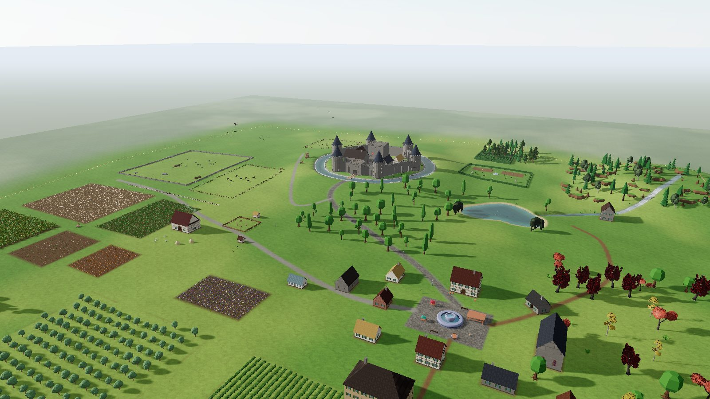

| | |
|---|---|
| 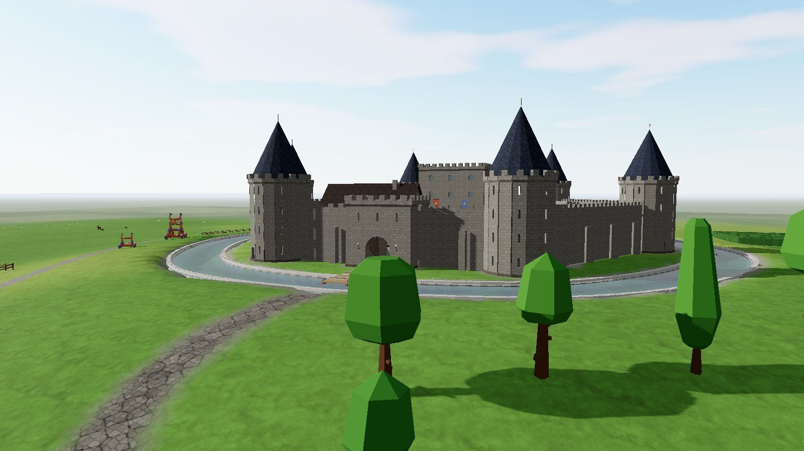 | 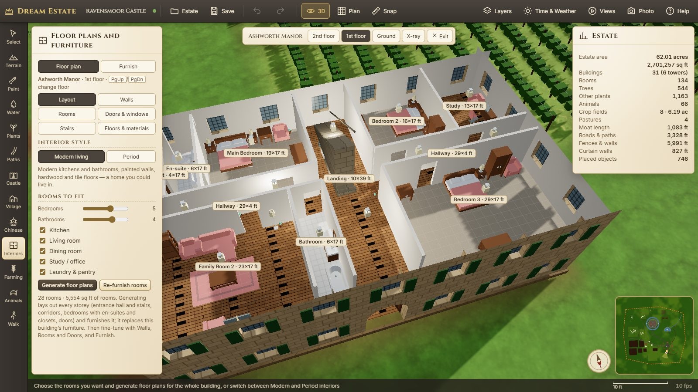 |
| 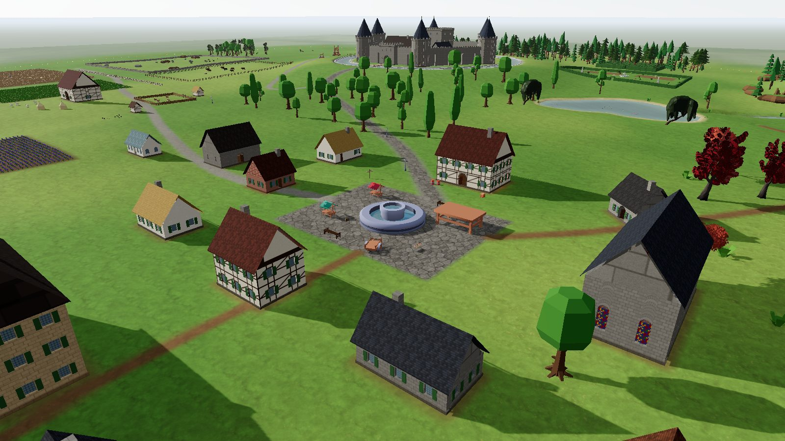 | 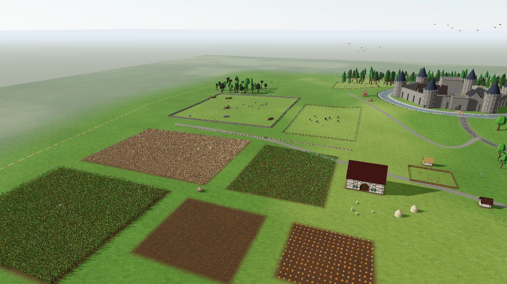 |
| 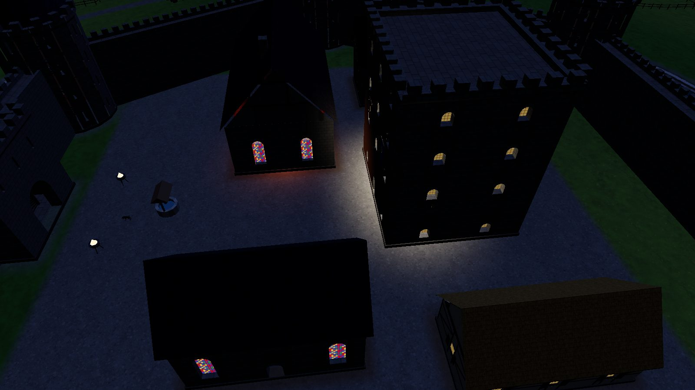 | 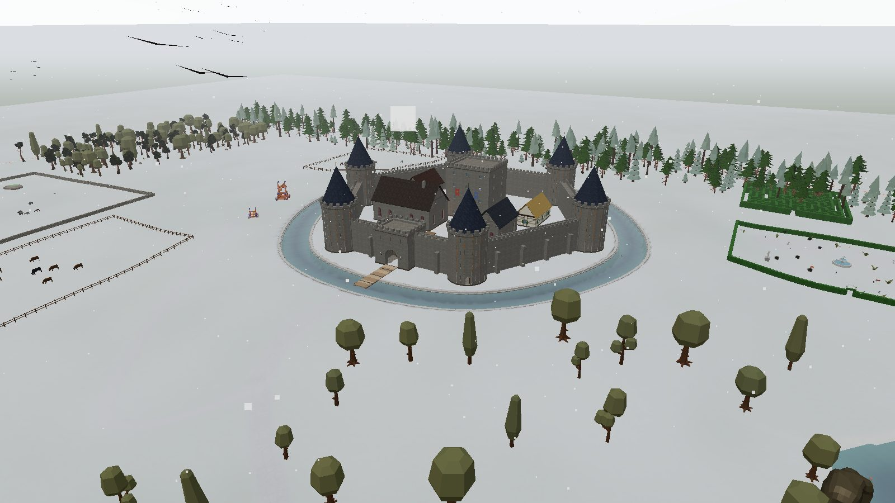 |
| 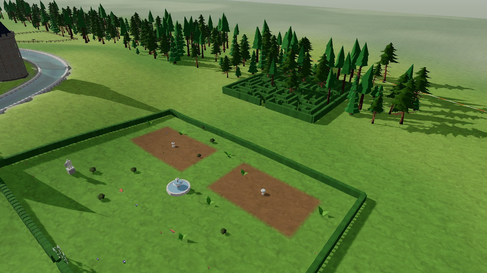 | 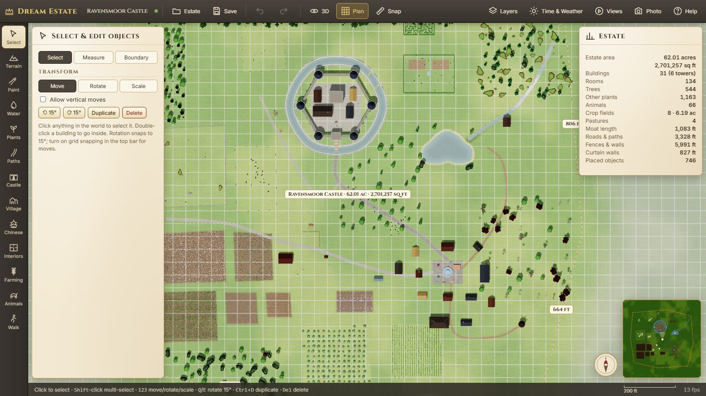 |
| 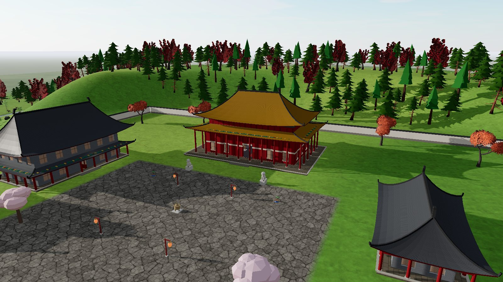 | 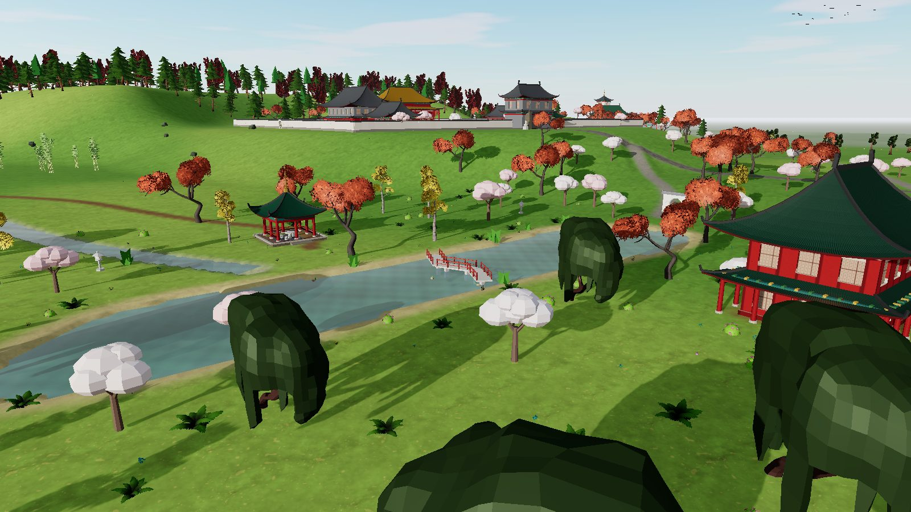 |
| 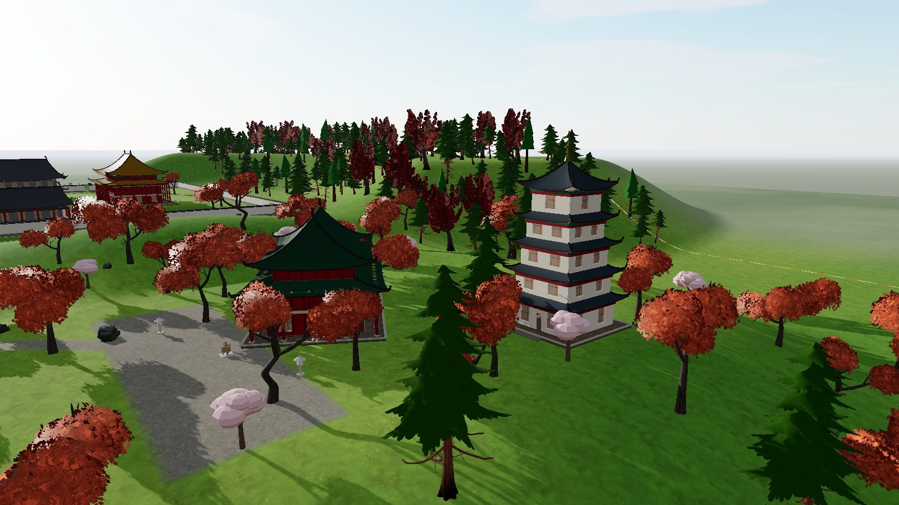 | 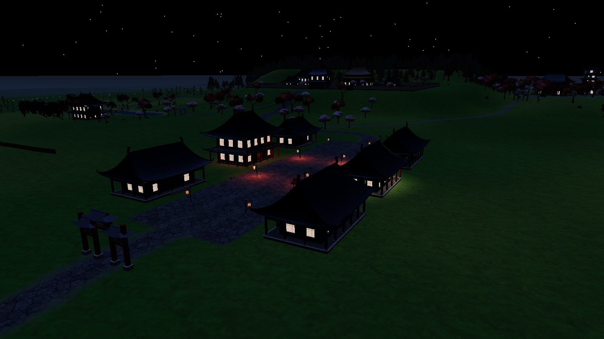 |
| 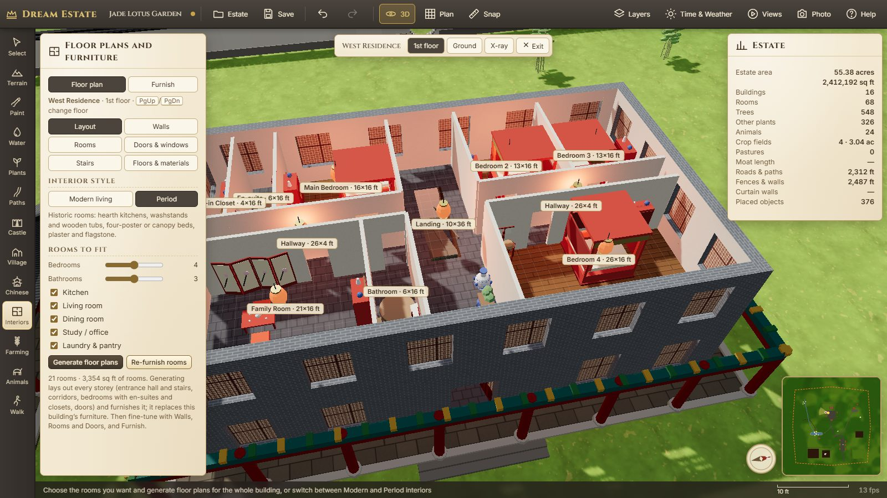 | |

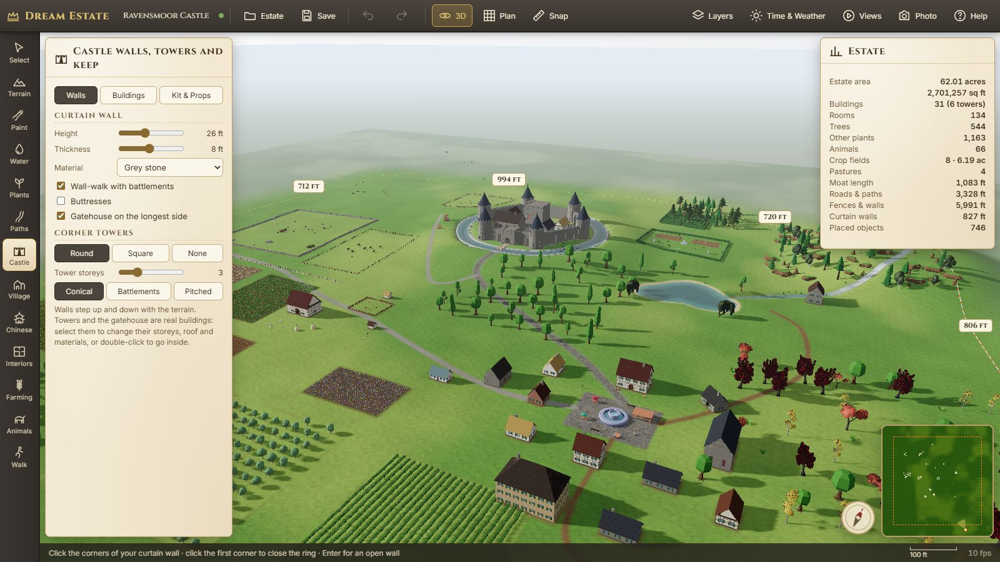

Everything runs in your browser. Your estates autosave to the browser's IndexedDB, and you can export them to a `.json` file to back them up or move them to another computer.

---

## Features

**Property and terrain**
- New Estate wizard: name the estate and set its size in acres or width × depth in feet, or draw a custom boundary polygon. Choose how hilly the land is.
- Surveyor-style property line with striped tape, corner stakes, edge lengths, and an area readout in acres and sq ft. Land outside the boundary fades into haze.
- Sculpting brushes: raise, lower, flatten (to the height where the stroke starts; Alt-click samples a height), smooth, roughen, and set an exact elevation. Size, strength and falloff are adjustable.
- Ten blended ground textures: grass, meadow, dirt, mud, gravel, cobblestone, sand, farmland, forest floor and rock. Steep slopes turn to rock automatically.
- Orbit, pan and zoom; a top-down plan view with a feet grid and scale bar; and a measuring tool for distance, elevation change and slope.

**Water and landscaping**
- Moat tool: draw a loop and the channel is carved into the land at a flat water level, with stone edging or earthen banks.
- Ponds and lakes (freehand). Streams follow the land downhill and form waterfalls on steep drops. Water is animated, with foam, and freezes in winter.
- Vegetation brush with scatter, single and erase modes. Plants get random scale, rotation and tint, and there are presets for woodland, pine forest, wildflower meadow, waterside reeds and boulders. Plants avoid water, buildings, roads and fields automatically.
- Formal gardens: flower beds, a hedge maze generator, fountains, statues, benches, a sundial and a rose arch.
- Roads in dirt, gravel or cobblestone flatten the ground across their width and follow the terrain along their length. Bridges are built automatically wherever a road crosses water.
- Fences and walls drawn along a line: wooden rail, picket, wattle, dry stone and hedge, with gates. Retaining walls and terraces for hillsides.

**Castle**
- Wall drawing tool: click to lay out curtain walls that step with the terrain, with a wall-walk, battlements, arrow slits and buttresses. Round or square towers are placed at every corner, and a gatehouse goes on the longest side.
- The gatehouse has a portcullis and a drawbridge that animate open and closed. "Dig a moat around these walls" lengthens the drawbridge to span the moat.
- Keep, round and square towers, great hall, chapel, barracks, armory and stables, plus the Kenney castle kit pieces, siege engines, banners, torches and a well.
- Adjustable height, wall thickness, storeys, roof style (conical, pitched, hipped, flat), roof colour, thatch, battlements, chimneys and materials (grey stone, sandstone, whitewash, half-timber, brick).

**Chinese style** (Chinese mode, key Y)
- Seven enterable buildings: a palace hall (double eaves, stone terrace, red colonnade), a temple, a five-storey pagoda whose storeys step inward, with an eave on every floor and a gilded finial, a brick gate tower, an open pavilion with benches, a courtyard house and a two-storey teahouse.
- Curved roofs with upturned corners and glazed tiles in any colour, hip ridges and ridge-end ornaments, and a painted bracket band (dougong) under the eaves. Any building can use them: choose *Curved eaves* as its roof, then set double eaves, eaves on every storey, storey taper (each storey steps inward, with its rooms, stairs and furniture fitted to it), veranda columns, a stone terrace or open sides.
- Red lacquer and grey brick walls, lattice doors and paper lattice windows that glow at night, and square-tile floors.
- Courtyard walls with tiled coping and **moon gates** wherever the wall has a gate, and bamboo fences.
- Garden pieces: stone lanterns, red lantern posts, zigzag and hump bridges, scholar rocks, guardian lions, an incense burner, a paifang archway, a free-standing moon gate, bonsai and a stone table with drum stools. Plants: cherry and plum blossom, bamboo groves, plus the red maples and golden birches from the nature packs.
- Furniture: canopy bed, official's armchair, dragon throne, folding screen, lacquered cabinet, scholar's desk, altar table, hanging scroll, porcelain vase, temple drum, gong, tea table and hanging red lanterns. Chinese buildings come furnished with these.
- The **Jade Lotus Garden** demo (`?demo=chinese`, or Estate ▸ Load Chinese demo estate) has a walled palace compound, a temple hill with the pagoda, a lotus pond and a teahouse street.

**Livable homes**
- Homes come with real floor plans: the manor house, cottages, longhouse, keep, Chinese courtyard house and family residence are laid out room by room and furnished when you build them.
- **Layout** tab (inside any rectangular building): choose bedrooms, bathrooms, kitchen, living room, dining room, study, laundry & pantry, and *Generate floor plans*. Every storey is laid out around an entrance hall with the staircase (or straight into the living room in a small cottage): corridors, a main bedroom with en-suite and walk-in closet, shared bathrooms, a cloakroom downstairs, interior walls and doors. Rooms that don't fit are reported. One undo step reverts it.
- **Modern or Period**, switchable per building. Modern: fitted kitchens (base and wall cabinets, sink, range and hood, fridge, island and stools), bathrooms (toilet, vanity and mirror, bath, shower), beds with bedside tables and lamps, wardrobes, sofas, TV, dining sets, desks, washer and dryer, ceiling lights; painted walls, hardwood, carpet and tile. Period: hearth kitchens, washstands and wooden tubs, garderobes, four-poster or Chinese canopy beds, plaster and flagstone (Chinese buildings get lacquered furniture, screens and lanterns).
- *Re-furnish rooms* furnishes any plan from its room types, including ones you drew yourself. Furniture keeps clear of doors, windows and stairwells.
- New room types: living, dining, bathroom, closet, hallway, laundry, office and pantry.

**Interiors**
- Double-click any building to go inside. The cutaway view hides the roof and the floors above, a floor selector switches levels, and X-ray mode makes the walls see-through.
- Floor plan editor: draw interior walls on a grid, define named and typed rooms, and add storeys, cellars and dungeons.
- Doors (wooden, arched, double), archways, windows (stained glass, arched, shuttered), arrow slits, and straight or spiral stairs. Stairs cut their own stairwell in the floor above.
- Floor, wall and ceiling materials: stone, plaster, wood panelling, tapestry, planks, flagstone, rug, brick, whitewash, red lacquer, square tiles, hardwood, carpet, white tiles and painted plaster. Ceilings can be flat, beamed or vaulted.
- Furniture catalog organised by room type: great hall, bedroom, kitchen, library, armory, chapel, cellar, dungeon, throne room and tavern. Wall items snap to walls and chandeliers hang from the ceiling. Candles, torches, chandeliers and fireplaces light rooms at night.

**Village and farming**
- Cottages (thatched, half-timbered, stone), longhouse, tavern, blacksmith, bakery, church, workshop, storehouse, a watermill with a turning wheel and a windmill with turning sails. All of them can be entered.
- Town square tool, market stalls, carts, barrels and lamp posts.
- Crop fields planted in rows: wheat, barley, corn, vegetables, pumpkins, lavender, vineyard rows and orchards, each with growth stages from plowed to ripe. Irrigation channels, hay bales, scarecrows and beehives.
- Pastures: draw an area and it's fenced with a gate automatically. Farm buildings include a barn, chicken coop, pig shed, dovecote and greenhouse.

**Animals**
- Horses, donkeys, cows and bulls, sheep and alpacas, goats, pigs, chickens and chicks, ducks, dogs, deer, stags and foxes. They idle, graze, walk and gallop.
- Animals wander naturally inside their pasture and avoid buildings, water and each other. Ducks paddle around their pond or the moat. Flocks of birds circle overhead.
- Herd tool: choose an animal, a count and a spread, then click a pasture, the water or open ground.

**Experience**
- First-person walk mode: WASD and mouse look. You collide with walls, climb stairs and terrain, walk through open doors and cross the drawbridge. E operates the nearest gate, and H puts you on horseback (Shift to gallop).
- Day/night cycle with a time slider. The sun and moon move, shadows follow, and torches, chandeliers and windows glow at night. Seasons change foliage, grass and snow. Weather can be clear, overcast, rain or fog.
- Minimap (click to fly there) and compass; photo mode with PNG export; saved viewpoints and a guided tour.

**Editing**
- Select, move, rotate (15° snaps), scale, duplicate and delete, with multi-select. Grid snapping with an adjustable grid size.
- Unlimited undo and redo for every action, including terrain, paint, planting and placement.
- Layer visibility, a searchable catalog with thumbnails, an estate statistics panel and a help overlay.
- Autosave, multiple named estates, JSON export/import, and the pre-built demo estate.

## Controls

| Action | Keys / mouse |
|---|---|
| Orbit / pan / zoom | Right-drag (or left-drag in Select) / middle-drag / wheel |
| Plan view | Tab |
| Modes | V Select · T Terrain · P Paint · W Water · G Plants · R Roads & fences · C Castle · B Village · Y Chinese · I Interiors · F Farming · A Animals · K Walk · M Measure |
| Undo / redo / save | Ctrl+Z / Ctrl+Y / Ctrl+S |
| Duplicate / delete | Ctrl+D / Del |
| Move / rotate / scale gizmo | 1 / 2 / 3 · Q/E rotate 15° · Shift-click multi-select |
| Brush size | [ and ] |
| Finish a drawn shape | Double-click or Enter (click the first point to close it) · Backspace removes the last point |
| Change floor (inside) | PgUp / PgDn |
| Walk mode | WASD, mouse, Shift run, Space jump, H horse, E gate, Esc exit |
| Photo mode / help | Shift+P / H or ? |

## Running locally

Requires Node 20+.

```bash
npm install
npm run dev          # http://localhost:5173/dream-estate-builder/
npm run build        # type-check + production build into dist/
npm run lint
npm run check        # build + lint
npx playwright install chromium   # first time only
npm run test:e2e     # headless browser tests (fail on any console error) + screenshots
```

Every push to `main` builds and deploys to GitHub Pages through `.github/workflows/deploy.yml`.

## Assets: the pipeline

The optimised models live in `public/models/<category>/*.glb` and are committed. Raw downloads go in `assets-raw/`, which is gitignored.

```bash
npm run build:assets                 # download → Blender generate → convert/optimise → thumbnails
node scripts/build-assets.mjs --skip-download --skip-blender   # re-convert only
node scripts/gen-thumbnails.mjs --force                        # re-render every thumbnail
```

1. **Download** (`scripts/download-assets.mjs`): fetches the Kenney kits through kenney.nl's download links. Quaternius models come individually from poly.pizza, with every file checked to be by Quaternius and licensed CC0. Quaternius' full packs (Medieval Village MegaKit, Stylized Nature MegaKit, Ultimate Stylized Nature, Ultimate Animated Animals) are manual downloads from quaternius.com / itch.io. Unzip each into its own folder under `assets-raw/` (for example `assets-raw/Quaternius Medieval Village MegaKit/`); the selection already points at their `glTF` folders and skips any pack that isn't there.
2. **Blender** (`blender/*.py`, run headless): generates the pieces the packs don't cover, in the same low-poly style. That covers moat edging, the drawbridge, portcullis, merlons, arrow slits, spiral stairs, banners, torches, braziers, the well, doors and windows; medieval furniture (four-poster bed, thrones, long tables, chandeliers, hearths, wine racks, casks, weapon racks, armour stands, pews, altar, cell bars and more); farm and garden props; and an animated **duck** and **goat** (rigged, with Idle/Walk/Eat/Swim clips). `generate_chinese.py` adds the Chinese lanterns, bridges, moon gate, scholar rock, guardian lion, paifang, blossom trees, bamboo and furniture.
3. **Convert** (`scripts/convert-assets.mjs`): rescales each model to real-world size, recentres it, recolours the Kenney Nature and Furniture palettes, converts textures to WebP, quantises and compresses with meshopt, and updates `src/catalog/catalog.json`. Groups marked `alphaMask` switch alpha-blended leaves to alpha-test so instanced foliage sorts correctly; normal and roughness maps are reduced to 256 px.
4. **Thumbnails** (`scripts/gen-thumbnails.mjs`): renders a WebP for each catalog entry with headless Chromium.

### Blender setup

The pipeline finds Blender through the `BLENDER_PATH` environment variable, then `PATH`, then the default install folder (`C:\Program Files\Blender Foundation\Blender 5.x\`). To put it on your PATH on Windows:

```powershell
# PowerShell (current user); open a new terminal afterwards
[Environment]::SetEnvironmentVariable("Path", $env:Path + ";C:\Program Files\Blender Foundation\Blender 5.2", "User")
# or point the pipeline at it directly:
[Environment]::SetEnvironmentVariable("BLENDER_PATH", "C:\Program Files\Blender Foundation\Blender 5.2\blender.exe", "User")
```

You can also run a single script yourself: `blender --background --factory-startup --python blender/generate_furniture.py -- assets-raw/blender`

### Adding a new model

1. Drop the `.glb` into `public/models/<category>/`.
2. Add one entry to `src/catalog/catalog.json`:
   ```json
   { "id": "my_cart", "name": "Hay Cart", "category": "farm", "tags": ["farm"], "model": "models/farm/my_cart.glb",
     "scale": 1, "footprint": [2, 3], "height": 2, "snap": "ground", "thumb": "thumbs/my_cart.webp",
     "roomTypes": ["stable"], "light": { "color": "#ffa040", "intensity": 6, "distance": 10, "y": 1.5 } }
   ```
   `snap` can be `ground`, `grid`, `floor`, `wall` (hugs walls) or `ceiling` (hangs). `roomTypes` shows the item as a suggestion in those rooms; `"*"` means every room. `light` makes the item glow at night.
3. Run `node scripts/gen-thumbnails.mjs` to render its thumbnail.

Alternatively, add it to `scripts/asset-selection.mjs` (source file plus real-world height) and run `npm run build:assets`. The model is then rescaled and optimised for you.

## Project layout

```
src/
  app/          App: renderer, loop, tools, picking, layers, quality presets
  core/         EstateDoc types, Store (change events), undo/redo commands, maths, geometry builder
  terrain/      chunked LOD terrain, splat shader, brushes, boundary, non-destructive terrain features
  water/        moats, ponds, streams, water shader
  vegetation/   instanced plants, scatter/erase, gardens and maze
  paths/        roads + auto-bridges, fences/hedges/walls, retaining walls
  buildings/    parametric building mesher, presets, curtain walls, castle tools, materials
  interiors/    cutaway, floor plan editor, furnish tool
  farming/      fields, crops, vineyards, orchards, pastures, town square
  animals/      animal behaviour, herd tool, birds
  catalog/      catalog.json, loader, placement tool, props system
  camera/       orbit/plan rig, walk mode, minimap, photo mode, viewpoints/tour
  environment/  sky, sun/moon, seasons, weather, pooled lights
  persistence/  IndexedDB autosave/slots, JSON import/export, demo estate
  ui/           top bar, toolbars, panels, catalog browser, wizard, help, theme
blender/        headless Blender generators       scripts/   asset pipeline
tests/          Playwright end-to-end tests        docs/      README screenshots
```

## Limitations

- **Water** is a stylised approximation, not a fluid simulation. Streams follow the course you draw and always flow downhill; ponds and moats fill to a flat level.
- **Animal behaviour** is steering, not full pathfinding: animals stay in their pasture and turn away from obstacles.
- **Buildings** are generated parametrically (rectangular or round footprints), so free-form building shapes aren't supported. Kenney castle kit pieces can be placed for extra detail.
- **Performance**: graphics quality is picked automatically. Integrated GPUs default to Medium; switch under Layers ▸ Quality if a large estate feels slow.

## Credits

All third-party assets are **CC0 1.0 (public domain)**.
- **Kenney** (https://kenney.nl): Castle Kit, Fantasy Town Kit, Nature Kit, Furniture Kit, Survival Kit, Graveyard Kit, Pirate Kit, Food Kit and Mini Dungeon. The Modular Dungeon and Holiday kits are downloaded too, but not used in the catalog yet.
- **Quaternius** (https://quaternius.com, models downloaded from https://poly.pizza): animated horses, cows, bulls, sheep, alpacas, pigs, chickens, chicks, dogs, huskies, shibas, deer, stags, donkeys and foxes, plus birch, willow and pine trees, bushes, flowers, a bookcase, chest, cauldron, shelves, beds, market stalls and benches. From the full packs: **Stylized Nature MegaKit** and **Ultimate Stylized Nature** (textured common trees, Scots pines, copper beeches, red maples, golden birches, dead trees, bushes, grasses, ferns, flowers, mushrooms, rocks and stepping-stone paths), **Medieval Village MegaKit** (the Building Kit category: 2 m modular plaster, timber and stone walls, floors, tiled roofs, dormers, chimneys, doors, windows, shutters, stairs, balconies, plus a wagon, crate, iron railings and climbing ivy) and **Ultimate Animated Animals** (the wolf).
- **This repository's Blender scripts** (`blender/`): castle pieces, medieval furniture, farm and garden props, the duck and goat, and the Chinese garden pieces, plants and furniture. Released under CC0 as well.
- Fonts: Cinzel and Inter (SIL Open Font License) from Google Fonts. Libraries: three.js, three-mesh-bvh, fflate, idb-keyval (MIT).
